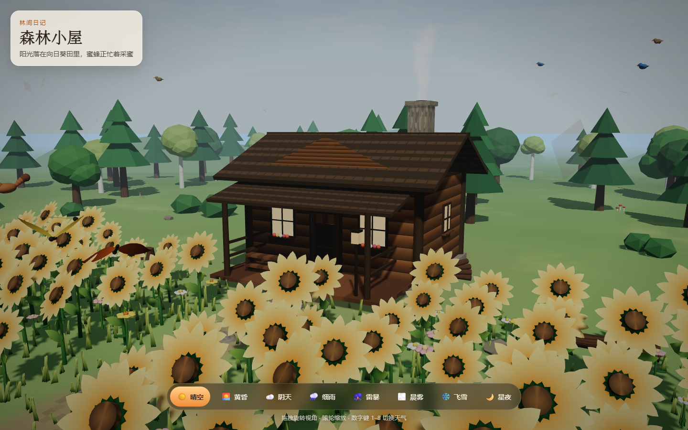

# gork4.7 森林小屋

用 Three.js 做的林间小屋。门前是一块向日葵空地，草丛里有低矮杂草，蝴蝶和蜜蜂在花间飞；树上停着松鼠、小鸟、猫头鹰和啄木鸟。晴空、黄昏、阴天、细雨、雷暴、晨雾、飞雪和星夜可以随时切换。



## 运行

```bash
npm install
npm run dev
```

浏览器打开终端里显示的本地地址。

## 操作

- 拖拽旋转视角，滚轮缩放
- 页面打开后会缓慢自动旋转，动一下鼠标即停止
- 点击底部天气按钮，或按数字键 `1`–`8` 切换天气

## 天气

| 按键 | 天气 |
| --- | --- |
| 1 | 晴空 |
| 2 | 黄昏 |
| 3 | 阴天 |
| 4 | 细雨 |
| 5 | 雷暴 |
| 6 | 晨雾 |
| 7 | 飞雪 |
| 8 | 星夜 |
